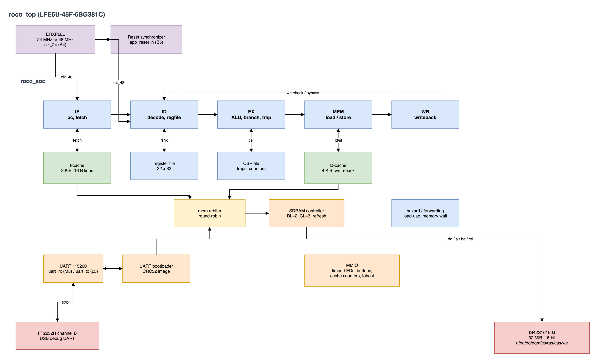

# roco CPU

A five-stage pipelined RV32I processor with instruction and data caches,
an Sv32 memory-management unit, an SDRAM controller, a UART bootloader
and a small memory-mapped peripheral set, targeting the roco Rev A board (Lattice LFE5U-45F-6BG381C,
16-bit SDR SDRAM, FT2232H UART).

The design is plain SystemVerilog with no vendor primitives below the
board top level, so it can be simulated with Icarus/Verilator and
synthesized with Yosys. `rtl/roco_top.sv` is the only file that
instantiates the ECP5 PLL.

## Block diagram



Editable source: [docs/roco-cpu.drawio](docs/roco-cpu.drawio).

`roco_top` contains the 24 MHz to 48 MHz PLL and reset synchronizer, and
instantiates `roco_soc`. Inside the SoC:

- `rv32_core` is the five-stage pipeline (IF, ID, EX, MEM, WB), built
  from the stage modules listed below. It contains the Sv32 MMU.
- `icache` and `dcache` are physically addressed and connect to
  `mem_arbiter`, which shares `sdram_ctrl` with the UART image loader and
  the MMU page-table walker.
- The uncached path decodes the UART, timer, LED, button, cache-counter,
  boot-status and `tohost` registers at physical addresses.

Pipeline: IF, ID, EX, MEM, WB. The I-cache streams one instruction per
cycle into a four-entry fetch queue; a 32-entry bimodal 2-bit predictor
with a BTB predicts taken branches so correctly predicted control
transfers do not flush the pipeline. Branches, jumps, traps, MRET and
SRET resolve in EX; a mispredict flushes two slots. Instruction fetches
are translated before the I-cache; data addresses are translated in EX
before the D-cache lookup and are carried to MEM as physical addresses.

The D-cache is looked up in EX and its data is available in MEM, so a
cache-hit load or store costs no extra cycle. Load data is forwarded
from the MEM stage to a dependent instruction in EX, and a store in MEM
is merged into a younger lookup of the same word (store-to-load
forwarding). Each stage lives in its own module and owns its pipeline
register:

| Module | Responsibility |
|---|---|
| `rv32_if_stage.sv` | Program counter, fetch handshake, IF/ID register |
| `rv32_decoder.sv` | Combinational instruction decode |
| `rv32_id_stage.sv` | Register file, ID/EX register |
| `rv32_ex_stage.sv` | Forwarding, ALU, branches, traps, CSR file, EX/MEM |
| `rv32_mem_stage.sv` | Data memory request, load alignment, MEM/WB |
| `rv32_wb_stage.sv` | Writeback select |
| `rv32_branch_predictor.sv` | Bimodal counters and BTB |
| `rv32_mmu.sv` | Sv32 TLBs, page-table walker, permission checks |

## Implemented ISA

- RV32I base integer instructions.
- Zicsr: `CSRRW/CSRRS/CSRRC` and immediate forms.
- M/S/U privilege modes, trap delegation through `medeleg`, and
  `MRET`/`SRET`.
- Sv32 virtual memory: 4 KiB pages, 4 MiB superpages, ASID and global
  mappings, `MPRV`/`SUM`/`MXR`, `SFENCE.VMA`, and instruction, load and
  store page faults.
- Traps: illegal instruction, `ECALL`, `EBREAK`, misaligned load/store,
  misaligned instruction address, instruction/load/store page faults.
- `FENCE` is a NOP; `FENCE.I` writes back the D-cache, invalidates the
  I-cache and flushes younger instructions. `SFENCE.VMA` additionally
  invalidates both TLBs.
- CSRs: `mstatus`, `misa`, `medeleg`, `mideleg`, `mie`/`mip`, `mtvec`,
  `mepc`, `mcause`, `mtval`, `mscratch`, `mcounteren`, `mcycle[h]`,
  `minstret[h]`; `sstatus`, `sie`/`sip`, `stvec`, `sepc`, `scause`,
  `stval`, `sscratch`, `scounteren`, `satp`, `mhartid`.

Not implemented: M/A/F/D/C extensions, interrupts, PMP, debug module,
`WFI`, hardware A/D-bit updates and ASID-selective `SFENCE.VMA`.
Misaligned loads and stores trap precisely; the official `rv32ui/ma_data`
test (which requires hardware misaligned access) is therefore excluded,
and the directed test checks the trap path instead.

## Privilege and virtual memory

Reset starts in M mode. Traps enter M mode at `mtvec`, or S mode at
`stvec` when the exception is enabled in `medeleg` and the trap did not
come from M mode. `ECALL` causes 8/9/11 distinguish U/S/M callers.
`MRET`/`SRET` restore the saved privilege and interrupt-enable state.
`mstatus` implements `MPRV`, `SUM`, `MXR`, `TVM` and `TSR`; `satp`
implements Sv32 mode with a 9-bit ASID.

The MMU has separate 16-entry direct-mapped ITLB and DTLB, tagged by
virtual page number. The ASID field is accepted, but a `satp` write or
`SFENCE.VMA` flushes both TLBs, so ASIDs do not tag the fast lookup
path. A shared hardware walker reads two PTEs through a dedicated
physical SDRAM-arbiter port. Superpages and 4 KiB pages are supported;
a superpage access is cached as the specific 4 KiB translation that
caused the walk. A/D bits are software-managed: a PTE with A=0, or D=0
for a store, raises a page fault. Page tables must reside in the 32 MiB
SDRAM window; physical addresses are the 32-bit subset of the Sv32
physical address space, so PPN bits 21:20 are zero.

M-mode instruction fetch bypasses translation; M-mode data accesses
translate only when `mstatus.MPRV` selects S or U. Page faults report
the faulting virtual address in `mtval`/`stval` and use causes 12, 13 and
15.

The walker reads SDRAM directly rather than through the D-cache, so
`SFENCE.VMA` first writes back the whole D-cache (the same sequence as
`FENCE.I`), invalidates the I-cache, and then invalidates both TLBs.
Software that updates a PTE must execute `SFENCE.VMA` before relying on
the new mapping. The address and ASID operands are decoded but ignored:
every `SFENCE.VMA` performs a complete flush.

## Caches and memory

| Cache | Size | Organisation | Policy |
|---|---|---|---|
| I-cache | 2 KiB | 128 lines x 16 B, direct mapped | read-only, whole-line fill |
| D-cache | 4 KiB | 256 lines x 16 B, direct mapped | write-back, write-allocate, byte enables |

The I-cache streams one response per cycle on hits. The D-cache is
looked up in EX: tags are compared combinationally and the data RAM read
is registered, so a hit is consumed in MEM without stalling. Both caches
are blocking on a miss: one memory transaction is outstanding per cache.
The D-cache data array is split into four byte-lane memories so ECP5
block RAMs implement byte enables. A dirty victim is written back before
the new line is fetched; a store miss fetches the line and then merges
the store bytes so partial writes never fabricate data. A single
word request from the bootloader and single-word PTE reads from the MMU
walker share the SDRAM controller through `mem_arbiter.sv` with
round-robin priority.

`sdram_ctrl.sv` drives the IS42S16160J at 48 MHz with BL=2 and CL=3.
Transactions move 32-bit words (two halfword beats), reads are pipelined
one word per two cycles, and the controller keeps a row open until a
different row or a refresh is needed. Power-up wait, precharge, two
auto-refreshes, mode register, tRCD/tRP/tRFC/tMRD/tWR waits and periodic
auto-refresh are implemented. A timing-checking behavioural model
(`sim/sdram_model.sv`) flags protocol violations in simulation.

## Memory map

| Address | Access | Function |
|---|---|---|
| `0x1000_0000` - `0x11FF_FFFF` | R/W, cached | 32 MiB SDRAM |
| `0x8000_0000` | R/W | UART data (read pops RX, write pushes TX) |
| `0x8000_0004` | R | UART status: bit0 TX ready, bit1 RX valid, bit3 RX overflow (read clears) |
| `0x8000_0010` | R/W | User LEDs |
| `0x8000_0014` | R | User buttons |
| `0x8000_0018/1c` | R | `mtime` low/high |
| `0x8000_0020/24` | R/W | `mtimecmp` low/high |
| `0x8000_0028` | R | Timer pending (`mtime >= mtimecmp`) |
| `0x8000_0030/34/38/3c` | R/W | I-cache hits/misses, D-cache hits/misses (write clears) |
| `0x8000_0048/4c` | R/W | Debug benchmark cycle/instruction counts |
| `0x8000_0100` | R | Boot status: bit0 done, bit1 busy, bit2 error, bit3 SDRAM ready |
| `0x8000_0104` | R | Loaded image base |
| `0x8000_0108` | W | Restart the bootloader |
| `0x8000_1000` | R/W | `tohost`: write halts the core, value is the exit code |

These are physical addresses. With paging enabled, virtual pages are
mapped onto them; page tables must live in SDRAM. Instruction fetch
outside SDRAM returns instruction 0 (illegal), which traps through the
current trap vector. Initially M-mode programs are linked at
`0x1000_0000`.

## Boot protocol

After reset the CPU is held in reset and the loader waits for a packet
consisting of the 4-byte magic `ROCO`, a little-endian 32-bit base, a
little-endian 32-bit length, a little-endian CRC-32 of the payload, and
then the payload itself.

Payload bytes are packed into 32-bit words and written to SDRAM at
`base`, which must be word aligned and inside `0x1000_0000` -
`0x11FF_FFFF`. On success the loader sends `K`, records `base` as the
CPU reset vector and releases the core. A framing, range or CRC error
sends `E` and returns to the magic search; the CPU stays in reset.

`scripts/boot.py` builds the packet from an ELF or flat binary, can emit
a byte-per-line hex file for simulation, and sends it over a serial
port:

```sh
python3 scripts/boot.py --elf build/hello.elf --port /dev/tty.usbserial-XXXX
```

The SDRAM controller needs about 200 us after reset; the script waits
350 ms before sending so the loader is ready.

## Building and testing

Requirements: Icarus Verilog, Verilator, Yosys, Verible, Python 3 and a
RISC-V ELF toolchain (`riscv64-elf-gcc` on `PATH`, or pass
`RISCV=/path/to/prefix`). `nextpnr-ecp5` and `ecppack` are only needed
for a bitstream.

```sh
make lint        # Verilator lint of the core, SDRAM controller and SoC
make test-core   # directed pipeline smoke test
make test-mm     # MMU unit test: translation, permissions, faults
make test-vm     # Sv32 software test on the core and through the SoC
make test-sdram  # SDRAM controller: bursts, refresh, retention
make test-soc    # same program through caches, arbiter and SDRAM
make test-isa    # official riscv-tests rv32ui on the bare core
make test-isa-soc # official riscv-tests rv32ui through the SoC
make test-boot   # boot the hello image over UART in simulation
make synth       # Yosys synth_ecp5 -> build/roco.json
make bitstream   # nextpnr-ecp5 + ecppack (if installed)
```

`make format` applies the repository Verible profile. The pre-commit
hook (`git config core.hooksPath .githooks`) checks formatting and
syntax of staged SystemVerilog.

## Verification status

Simulation (2026-11, Icarus Verilog 13):

- Directed smoke test: 20/20 checks.
- MMU unit test: bypass, two-level walk, TLB hit, 4 MiB superpage,
  permission faults, fetch fault and `SFENCE.VMA` invalidate pass.
- `sw/tests/vm.S`: MPRV translation, PTE remap after `SFENCE.VMA`,
  U-mode execution, load/store/instruction page faults, S-mode execution,
  delegated `ECALL` and `SRET` pass on the bare core and through the SoC.
- `riscv-tests` rv32ui: 41/41 on the bare core and 41/41 through the
  cached SoC. `ma_data` is excluded by design (see above).
- SDRAM controller: bursts, row/bank changes, refresh and data
  retention pass with zero timing-check violations.
- Hello program: PASS through the backdoor preload and through the
  UART bootloader.

## Known limitations and next steps

- The branch predictor is small (32 entries, bimodal) and JALR always
  mispredicts. A larger BTB and a return-address stack are the next
  steps.
- The D-cache is blocking on misses and has no write buffer.
- There is no cache coherence: `FENCE.I` flushes the D-cache and
  invalidates the I-cache, and `SFENCE.VMA` uses the same flush before
  invalidating the TLBs. There is no DMA or second master.
- The TLBs are 16-entry direct mapped and share one walker, so a
  conflict or concurrent I/D miss costs a page-table walk.
- A/D bits are software-managed, and `SFENCE.VMA` always flushes
  everything rather than a single address or ASID.
- Boot is over UART only. Booting from the W25Q128 flash needs an SPI
  controller and a flash-resident loader.
- `mtvec` supports direct mode only and interrupts are not wired to the
  core.
- The core has no M extension, so software must avoid compiler-emitted
  multiply/divide.

## Layout

| Path | Contents |
|---|---|
| `rtl/roco_top.sv` | Board top: PLL, reset, buttons, pins |
| `rtl/roco_soc.sv` | CPU, caches, memory, peripherals, bootloader |
| `rtl/core/` | Pipeline stages, decoder, ALU, CSR, regfile, MMU |
| `rtl/mem/` | I/D caches, arbiter, SDRAM controller |
| `rtl/periph/` | UART and UART image loader |
| `rtl/common/` | Shared RV32 control encodings |
| `constraints/roco.lpf` | ECP5 pin locations and clock constraint |
| `sim/` | Testbenches and the SDRAM behavioural model |
| `sw/` | crt0, linker script, hello/cache demo, VM tests |
| `tests/` | riscv-tests environment and linker script |
| `scripts/` | ISA runner, image converter, host bootloader |
| `docs/` | Block diagram source and preview |
