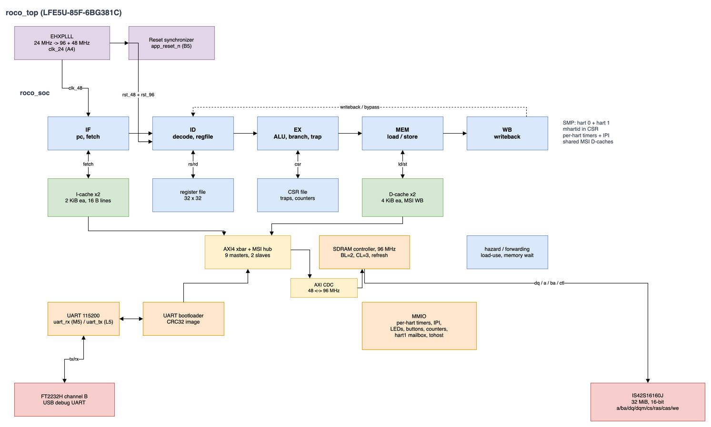

# roco_cpu

A five-stage pipelined RV32I processor with instruction and data caches,
an Sv32 memory-management unit, an SDRAM controller, a UART bootloader
and a small memory-mapped peripheral set, targeting the roco Rev B board (Lattice LFE5U-85F-6BG381C,
16-bit SDR SDRAM, FT2232H UART).

The design is plain SystemVerilog with no vendor primitives below the
board top level, so it can be simulated with Icarus/Verilator and
synthesized with Yosys. `rtl/roco_top.sv` is the only file that
instantiates the ECP5 PLL.

See [FPGA timing notes](docs/timing.md) for build reproduction and
validation coverage.

## Block diagram



Editable source: [docs/roco_cpu.drawio](docs/roco_cpu.drawio).

`roco_top` contains the 24 MHz reference PLL (96 MHz SDRAM + 48 MHz core
outputs) and per-domain reset synchronizers, and instantiates `roco_soc`.
Inside the SoC:

- Two `roco_cpu` harts (`mhartid` 0/1) run the five-stage pipeline
  (IF, ID, EX, MEM, WB), built from the stage modules listed below.
  Each hart contains its own Sv32 MMU and TLBs.
- Per-hart `icache` and `dcache` are physically addressed and share the
  SDRAM controller with the UART image loader and both MMU walkers over a
  nine-master AXI4 crossbar and a clock-domain-crossing bridge. An MSI
  snooping hub keeps the D-caches coherent; see [the bus architecture](docs/bus.md).
- Uncached data accesses reach the UART, timers, GPIO, cache counters,
  boot status, and `tohost` through an AXI4-to-APB4 bridge.
  See [the bus architecture](docs/bus.md) for routing and protocol limits.

Pipeline: IF, ID, EX, MEM, WB. The I-cache feeds a four-entry fetch
queue, and a 32-entry bimodal 2-bit predictor with a BTB predicts taken
branches. Branches, jumps, MRET and SRET resolve in EX. Traps record
their PC, cause and value before entry. Pending traps and registered
redirects cancel younger EX side effects and flush fetch/decode.
Instruction fetches are translated before the I-cache; data addresses
are translated in EX before the D-cache lookup and are carried to MEM
as physical addresses.

The D-cache accepts lookups in EX and consumes hits in MEM. Load data is
forwarded from the MEM stage to a dependent instruction in EX, and a
store in MEM is merged into a younger lookup of the same word
(store-to-load forwarding). Each stage lives in its own module and owns
its pipeline register:

| Module | Responsibility |
|---|---|
| `roco_cpu_if_stage.sv` | Program counter, fetch handshake, IF/ID register |
| `roco_cpu_decoder.sv` | Combinational instruction decode |
| `roco_cpu_id_stage.sv` | Register file, ID/EX register |
| `roco_cpu_ex_stage.sv` | Forwarding, ALU, branches, traps, CSR file, EX/MEM |
| `roco_cpu_mem_stage.sv` | Data memory request, load alignment, MEM/WB |
| `roco_cpu_wb_stage.sv` | Writeback select |
| `roco_cpu_branch_predictor.sv` | Bimodal counters and BTB |
| `roco_cpu_mmu.sv` | Sv32 TLBs, page-table walker, permission checks |

## Implemented ISA

- RV32I base integer instructions.
- Integer multiply/divide, LR/SC and atomic memory operations, on cached
  SDRAM words and on uncached MMIO registers alike. A cached atomic takes its
  old value from the EX cache lookup; an uncached one reads the old value over
  the uncached data port and then performs exactly one write.
- Zicsr: `CSRRW/CSRRS/CSRRC` and immediate forms.
- M/S/U privilege modes, trap delegation through `medeleg`, and
  `MRET`/`SRET`.
- Sv32 virtual memory: 4 KiB pages, 4 MiB superpages, global mappings,
  `MPRV`/`SUM`/`MXR`, `SFENCE.VMA`, and instruction, load and store page
  faults. The 9-bit ASID field is accepted, but invalidation is full-flush.
- Traps: illegal instruction, `ECALL`, `EBREAK`, misaligned load/store,
  misaligned instruction address, instruction/load/store page faults.
- `FENCE` is a NOP; `FENCE.I` writes back its own hart's D-cache,
  invalidates both I-caches and flushes younger instructions.
  `SFENCE.VMA` additionally invalidates both TLBs.
- Trap vectors: direct and vectored `mtvec`/`stvec` modes.
- CSRs: `mstatus`, `misa`, `medeleg`, `mideleg`, `mie`/`mip`, `mtvec`,
  `mepc`, `mcause`, `mtval`, `mscratch`, `mcounteren`, `mcycle[h]`,
  `minstret[h]`; `sstatus`, `sie`/`sip`, `stvec`, `sepc`, `scause`,
  `stval`, `sscratch`, `scounteren`, `satp`, `mhartid`.

Not implemented: F/D/C extensions, PMP, debug module, hardware A/D-bit
updates and ASID-selective `SFENCE.VMA`. `WFI` is accepted as a no-op hint.
Machine timer/software interrupts and an external interrupt input are
implemented by the core; the SoC currently wires only the timer interrupt.
Misaligned loads and stores trap precisely; the official `rv32ui/ma_data`
test (which requires hardware misaligned access) is therefore excluded,
and the directed test checks the trap path instead.

## Privilege and virtual memory

Reset starts in M mode. Traps enter M mode at `mtvec`, or S mode at
`stvec` when the exception is enabled in `medeleg` and the trap did not
come from M mode. `ECALL` causes 8/9/11 distinguish U/S/M callers.
`MRET`/`SRET` restore the saved privilege and interrupt-enable state.
`mstatus` implements `MPRV`, `SUM`, `MXR`, `TVM` and `TSR`; `satp`
implements Sv32 mode with a 9-bit ASID.

The MMU has separate 16-entry direct-mapped ITLB and DTLB, tagged by
virtual page number. The ASID field is accepted, but a `satp` write or
`SFENCE.VMA` flushes both TLBs, so ASIDs do not tag the fast lookup
path. A shared hardware walker reads two PTEs through a dedicated
physical AXI4 read master port. Superpages and 4 KiB pages are supported;
a superpage access is cached as the specific 4 KiB translation that
caused the walk. A/D bits are software-managed: a PTE with A=0, or D=0
for a store, raises a page fault. Page tables must reside in the 32 MiB
SDRAM window; physical addresses are the 32-bit subset of the Sv32
physical address space, so PPN bits 21:20 are zero.

M-mode instruction fetch bypasses translation; M-mode data accesses
translate only when `mstatus.MPRV` selects S or U. Page faults report
the faulting virtual address in `mtval`/`stval` and use causes 12, 13 and
15.

The walker reads SDRAM directly rather than through the D-cache, so
`SFENCE.VMA` first writes back the requester's whole D-cache (the same
sequence as `FENCE.I`), invalidates the I-cache, and then invalidates both
TLBs.
Software that updates a PTE must execute `SFENCE.VMA` before relying on
the new mapping. SATP writes replay younger fetches from the next
instruction so invalidation cannot drop an in-flight instruction. The address and ASID operands are decoded but ignored:
every `SFENCE.VMA` performs a complete flush.

## Caches and memory

| Cache | Size | Organisation | Policy |
|---|---|---|---|
| I-cache | 2 KiB | 128 lines x 16 B, direct mapped | read-only, whole-line fill |
| D-cache | 4 KiB | 128 lines x 32 B, direct mapped | write-back, write-allocate, byte enables |

The D-cache is looked up in EX: tag reads are registered and compared in
MEM. A LUT-RAM mirror registers aligned scalar values for immediate
forwarding, alongside the block-RAM data used for committed reads and
writeback. Stores and refills update both copies. Hits are consumed in
MEM. Both caches are blocking on a miss: one memory transaction is
outstanding per cache.

Atomic read-modify-write keeps the port busy across two phases. For a cached
word the EX lookup already supplies the old value, so MEM commits the single
write directly. A word outside SDRAM has no cache to answer that lookup, so
MEM publishes `dmem_amo_read` for one phase and the peripheral's read response
is captured before the write is issued. `sw/tests/atomic_mmio.S` checks the
returned old value and that exactly one write reaches the register.

The D-cache data array is split into four byte-lane memories so ECP5
block RAMs implement byte enables. A dirty victim is written back before
the new line is fetched; a store miss fetches the line and then merges
the store bytes so partial writes never fabricate data. A single
word request from the bootloader and single-word PTE reads from the MMU
walker share the SDRAM controller through `axi4_xbar.sv` with
round-robin arbitration.

`sdram_ctrl.sv` drives the IS42S16160J at 96 MHz with BL=2 and CL=3.
Transactions move 32-bit words (two halfword beats), reads are pipelined
one word per two cycles, and the controller keeps a row open until a
different row or a refresh is needed. Power-up wait, precharge, two
auto-refreshes, mode register, tRCD/tRP/tRFC/tMRD/tWR waits and periodic
auto-refresh are implemented. The power-up wait is the `SDRAM_POWERUP`
parameter (default `CLK_HZ / 5000`); formal cover runs shorten it so the CPU
reaches running traffic inside a bounded search. A timing-checking behavioural model
(`sim/sdram_model.sv`) flags protocol violations in simulation.

## Memory map

| Address | Access | Function |
|---|---|---|
| `0x1000_0000` - `0x11FF_FFFF` | R/W, cached | 32 MiB SDRAM |
| `0x8000_0000` | R/W | UART data (read pops RX, write pushes TX) |
| `0x8000_0004` | R | UART status: bit0 TX ready, bit1 RX valid, bit3 RX overflow (read clears) |
| `0x8000_0010` | R/W | User LEDs |
| `0x8000_0014` | R | User buttons |
| `0x8000_0018/1c` | R | `mtime` low/high |
| `0x8000_0020/24` | R/W | Hart0 `mtimecmp` low/high |
| `0x8000_0028` | R | Hart0 timer pending (`mtime >= mtimecmp`) |
| `0x8000_002c` | R | Hart1 timer pending |
| `0x8000_0050/54` | R/W | Hart0/hart1 software interrupt (IPI, bit0) |
| `0x8000_0060/64` | R/W | Hart1 `mtimecmp` low/high |
| `0x8000_0030/34/38/3c` | R/W | I-cache hits/misses, D-cache hits/misses (write clears) |
| `0x8000_0048/4c` | R/W | Debug benchmark cycle/instruction counts |
| `0x8000_0100` | R | Boot status: bit0 done, bit1 busy, bit2 error, bit3 SDRAM ready |
| `0x8000_0104` | R | Loaded image base |
| `0x8000_0108` | W | Restart the bootloader (re-parks hart1) |
| `0x8000_0110` | R/W | Hart1 boot address |
| `0x8000_0114` | R/W | Hart1 release (any write releases hart1; reads status) |
| `0x8000_1000` | R/W | `tohost`: write halts both cores, value is the exit code |

These are physical addresses. With paging enabled, virtual pages are
mapped onto them; page tables must live in SDRAM. The APB bridge decodes word
addresses, so a byte or halfword load inside a register word returns that lane
of the register; offsets that name no register read zero and ignore writes. Instruction fetch
outside SDRAM returns instruction 0 (illegal), which traps through the
current trap vector. Initially M-mode programs are linked at
`0x1000_0000`.

## Boot protocol

Writing the boot-restart register holds the CPU in reset, writes back dirty
D-cache lines, waits for SDRAM writes to drain, and invalidates both caches
before the loader can write a replacement image. Committed data outside the
replacement image is preserved. Accepted memory transactions continue to
drain while the CPU resets.

After reset the CPU is held in reset and the loader waits for a packet
consisting of the 4-byte magic `ROCO`, a little-endian 32-bit base, a
little-endian 32-bit length, a little-endian CRC-32 of the payload, and
then the payload itself.

Payload bytes are packed into 32-bit words and written to SDRAM at
`base`, which must be word aligned and inside `0x1000_0000` -
`0x11FF_FFFF`. On success the loader sends `K`, records `base` as the
CPU reset vector and releases the core. A framing, range or CRC error
sends `E` and returns to the magic search; the CPU stays in reset.

`scripts/boot.py` builds the packet from an ELF or flat binary, can emit
a byte-per-line hex file for simulation, and sends it over a serial
port:

```sh
python3 scripts/boot.py --elf build/hello.elf --port /dev/tty.usbserial-XXXX
```

The SDRAM controller needs about 200 us after reset; the script waits
350 ms before sending so the loader is ready.

## Building and testing

Requirements: Icarus Verilog, Verilator, Yosys, Verible, Python 3, CMake,
and a C++20 compiler for the sibling `../cc` toolchain. Directed tests use `../cc/build/roco_as`, `roco_ld`, and `roco_cc`; `make roco_tools`
builds them. Only the official ISA suites need a RISC-V ELF toolchain
(`riscv64-elf-gcc` on `PATH`, or pass `RISCV=/path/to/prefix`).
`nextpnr-ecp5` and `ecppack` are only needed
for a bitstream.

```sh
make roco_tools  # build ../cc/roco_as, roco_ld and roco_cc
make lint        # Verilator lint of the core, SDRAM controller and SoC
make test_core   # directed pipeline smoke test
make test_cpi    # run core and SoC CPI regressions
make test_atomic_order # atomic ordering under cache conflicts
make test_atomic_mmio # uncached atomics return the old value and write once
make test_vector_reduce # randomized reduction arithmetic checks
make test_vector_c # C workload through roco_cc
make test_mm     # MMU unit test: translation, permissions, faults
make test_vm     # Sv32 software test on the core and through the SoC
make test_sdram  # SDRAM controller: bursts, refresh, retention
make test_soc    # same program through caches, AXI4, SDRAM, and APB
make test_smp     # dual-hart bring-up: release, coherence, cross-hart AMOs
make test_bus    # crossbar, SDRAM adapter, and APB bridge regressions
make test_dcache # D-cache refill, eviction, forwarding and flush
make test_isa    # official riscv-tests rv32ui on the bare core
make test_isa_soc # official riscv-tests rv32ui through the SoC
make test_boot   # boot the minimal hello image over UART in simulation
make test_hello  # full hello demo over UART (slower)
make synth       # Yosys synth_ecp5 -> build/roco.json
make bitstream   # nextpnr-ecp5 + ecppack (if installed)
```

Directed core and SoC tests default to Verilator (`SIM=verilator`).
The first run builds `build/vl_tb_core/tb_core_vl` and
`build/vl_tb_soc/tb_soc_vl`; subsequent runs are compiled simulation and
are much faster than Icarus. Unit tests, the boot/UART tests, and the
official ISA suites stay on Icarus. Use `make test_core SIM=icarus` (or
`SIM=icarus` on any directed target) to run the same test through Icarus.

C tests compile with `ROCO_CCFLAGS`, which defaults to `-O0` so directed
tests keep the exact unoptimized instruction pattern. Build an optimized
variant explicitly when measuring the compiler:

```sh
make test_vector_c ROCO_CCFLAGS=-O2
ROCO_CCFLAGS="-O2 --cost-model ../cc/targets/roco_soc.costs" make test_hello
```

`make format` applies the repository Verible profile. The pre-commit
hook (`git config core.hooksPath .githooks`) checks formatting and
syntax of staged SystemVerilog.

## Verification status

See [formal verification](docs/formal.md) for the RVFI/RV32I, cache, AXI4,
SDRAM and whole-SoC checks and how to run them. Every gated job also runs
`cover` mode, so a witness state that becomes unreachable fails CI instead of
leaving a proof that passes vacuously:

```sh
bash formal/run.sh soc-fetch-memory prove
bash formal/run.sh icache cover
COVER_FAST=1 DEPTH=80 bash formal/run.sh soc-fence cover
```

Simulation (2026-11, Verilator 5.054 and Icarus Verilog 13):

- Directed smoke test: 20/20 checks.
- MMU unit test: bypass, two-level walk, TLB hit, 4 MiB superpage,
  permission faults, fetch fault and `SFENCE.VMA` invalidate pass.
- `sw/tests/vm.S`: MPRV translation, PTE remap after `SFENCE.VMA`,
  U-mode execution, load/store/instruction page faults, S-mode execution,
  delegated `ECALL` and `SRET` pass on the bare core and through the SoC.
- `riscv-tests` rv32ui: 41/41 on the bare core and 41/41 through the
  cached SoC. `ma_data` is excluded by design (see above).
- SDRAM controller: bursts, row/bank changes, refresh and data
  retention pass with zero timing-check violations.
- `sw/tests/atomic_mmio.S`: uncached AMO returns the peripheral's old value
  and writes exactly once.
- Hello program: PASS through the backdoor preload and through the
  UART bootloader.

## Known limitations and next steps

- The branch predictor is small (32 entries, bimodal). JALR predicts its
  last resolved target. Changing targets and BTB conflicts still cause
  recovery.
- The D-cache is blocking on misses and has no write buffer.
- Coherence is MSI write-back snooping without an Exclusive-clean
  state: every fill is shared and every store/atomic upgrade invalidates
  the peer (dirty lines are written back first). Share writable data with
  AMO/LR/SC or uncached MMIO; plain stores do not invalidate the peer.
  `FENCE.I`/`SFENCE.VMA` write back only the requester's D-cache, then
  broadcast the I-cache and TLB invalidation to both harts. Only the
  requester is released; a full flush of the peer's cache would drop a
  lookup it issues during the flush window.
- Each hart has a private TLB pair fed by its own walker; shootdown is the
  broadcast above rather than per-address invalidation.
- The TLBs are 16-entry direct mapped, so a conflict or concurrent I/D
  miss costs a page-table walk.
- A/D bits are software-managed, and `SFENCE.VMA` always flushes
  everything rather than a single address or ASID.
- An atomic to an uncached address is a read followed by one write. The value
  the peripheral returns is the operand of the operation; the pair is not
  atomic against other bus masters, but LR/SC reservations are global: a
  committed store from either hart clears the other hart's reservation.
- Boot is over UART only. Booting from the W25Q128 flash needs an SPI
  controller and a flash-resident loader.
- The SoC wires per-hart machine timer interrupts plus per-hart software
  (IPI) interrupts through the `0x50/0x54` mailboxes, but leaves the external
  interrupt input tied low and has no full CLINT. Software interrupts are
  also raised through writable `mip` bits.

## Layout

| Path | Contents |
|---|---|
| `rtl/roco_top.sv` | Board top: PLL, reset, buttons, pins |
| `rtl/roco_soc.sv` | SoC: roco_cpu, caches, memory, peripherals, bootloader |
| `rtl/core/` | Pipeline stages, decoder, ALU, CSR, regfile, MMU |
| `rtl/mem/` | I/D caches and SDRAM controller |
| `rtl/bus/` | AXI4 crossbar, memory adapters, and APB4 bridge |
| `rtl/periph/` | UART and UART image loader |
| `rtl/common/` | Shared RV32 control encodings |
| `constraints/roco.lpf` | ECP5 pin locations and clock constraint |
| `sim/` | Testbenches and the SDRAM behavioural model |
| `formal/` | SymbiYosys jobs, RTL checkers and RVFI harnesses |
| `sw/` | crt0, linker script, hello/cache demo, VM tests |
| `tests/` | riscv-tests environment and linker script |
| `scripts/` | ISA runner, image converter, host bootloader |
| `docs/` | Bus, timing and formal documentation, block diagram |
